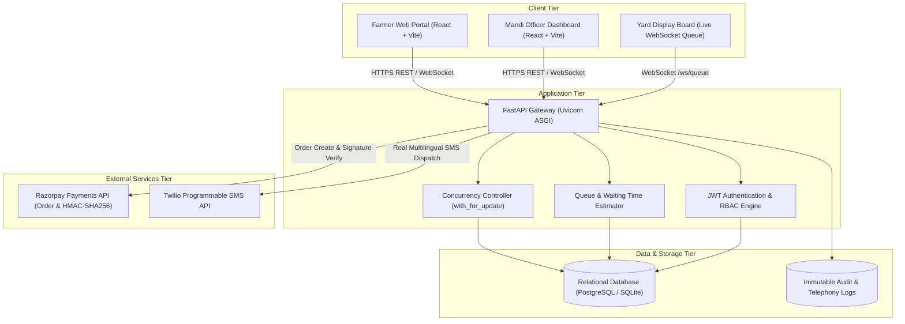

# AGRI-FLOW: Smart Mandi Slot Booking, Real-Time Queue Management & Procurement Platform

> **Modernizing Agricultural Supply Chains Through Fair Scheduling, Real-Time Mandi Yard Orchestration, and Automated Multilingual Farmer Telephony.**

[](https://github.com/agriflow/agriflow/actions)
[](https://www.typescriptlang.org/)
[](https://react.dev/)
[](https://fastapi.tiangolo.com/)
[](https://www.sqlalchemy.org/)
[](https://vitest.dev/)
[](https://pytest.org/)
[](LICENSE)

---

## 1. Problem Statement

Agricultural markets (APMC Mandis) across India experience severe congestion during peak harvest seasons:
- **Chaotic Yard Congestion**: Thousands of tractor-trolleys arrive simultaneously without scheduling, causing multi-kilometer traffic jams.
- **Prohibitive Waiting Times**: Smallholder farmers routinely wait 18 to 48 hours in Mandi yards, leading to post-harvest crop degradation, exposure to inclement weather, and lost labor days.
- **Opacities in Queue Progression**: Without transparent queue tracking, farmers are vulnerable to queue-jumping and lack predictable timing for unloading.
- **Communication Gaps**: Crucial procurement confirmations, counter call-outs, and payment receipts fail to reach farmers in their regional languages via accessible telecommunication channels (SMS).

---

## 2. Proposed Solution

**AGRI-FLOW** is a full-stack, enterprise-grade digital grain procurement and yard orchestration platform:
1. **Pessimistic Slot Allocation**: Farmers reserve guaranteed delivery windows with strict capacity capping (weight in kilograms and vehicle count).
2. **Nominal Commitment Deposit**: A secure ₹10 token reservation powered by Razorpay prevents phantom bookings and frivolous slot hoarding.
3. **Dynamic Queue & Yard Orchestration**: Live electronic queue tokens with dynamic position updates, assigned counter dispatch, and real-time waiting time estimation.
4. **End-to-End Procurement Receipts**: Mandi officers record certified weighbridge weights, moisture content, and quality grades, calculating instant MSP disbursements.
5. **Real Multilingual Telephony**: Production Twilio SMS integration delivers localized alerts in Hindi, Tamil, Telugu, Kannada, and English with fallback queuing.

---

## 3. System Architecture



---

## 4. Technology Stack

| Domain | Technology | Version | Purpose |
| :--- | :--- | :--- | :--- |
| **Frontend Framework** | React | 18.3.1 | Component-based interactive user interface |
| **Build & Dev Tool** | Vite | 5.4.21 | Ultra-fast HMR and optimized production bundling |
| **Language** | TypeScript | 5.5.3 | Static typing, interface contracts, compile safety |
| **Styling** | Tailwind CSS | 3.4.1 | Agricultural aesthetic design system (Emerald / Green) |
| **Icons** | Lucide React | 0.344.0 | Accessible vector UI icons |
| **Frontend Testing** | Vitest + Testing Library | 2.1.8 | Unit & integration testing with jsdom |
| **Backend Framework** | FastAPI | 0.110.0+ | High-performance asynchronous REST API & WebSockets |
| **Server Engine** | Uvicorn (standard) | 0.28.0+ | ASGI production server |
| **ORM / Database** | SQLAlchemy | 2.0.28+ | Dialect-agnostic relational ORM |
| **Databases** | SQLite / PostgreSQL | 3.x / 14+ | Local testing / Production scalable persistence |
| **Authentication** | Passlib (Bcrypt) + Python-JOSE | 1.7.4 / 3.3.0 | Salted password hashing & RS256/HS256 JWT tokens |
| **Payment Gateway** | Razorpay SDK | 1.4.1 | Order generation & cryptographic HMAC verification |
| **SMS Telephony** | Twilio REST SDK | 9.0.0+ | Real-time SMS dispatch across global carriers |
| **Backend Testing** | Pytest + HTTPX | 8.1.1+ | Automated unit, schema, and API integration tests |

---

## 5. Repository Directory Structure

```
raale/
├── .github/
│   └── workflows/
│       └── ci.yml                     # Automated CI pipeline (lint, test, build)
├── backend/
│   ├── app/
│   │   ├── core/
│   │   │   ├── config.py              # Pydantic environment configuration
│   │   │   ├── database.py            # Engine, sessionmaker, auto-migrations
│   │   │   └── security.py            # Bcrypt hashing & JWT token validation
│   │   ├── models/
│   │   │   └── models.py              # 15 SQLAlchemy relational database models
│   │   ├── routers/
│   │   │   ├── auth.py                # Registration, login, profile endpoints
│   │   │   ├── bookings.py            # Farmer booking creation & history
│   │   │   ├── centres.py             # Mandi centres, capacity & operational rules
│   │   │   ├── crops.py               # Crop master & yield tracking
│   │   │   ├── notifications.py       # SMS dispatch, history & Twilio webhooks
│   │   │   ├── officer.py             # Counter desk workflows & yard operations
│   │   │   ├── payments.py            # Razorpay ₹10 order & webhook verification
│   │   │   ├── procurements.py        # Quality grading & MSP purchase receipts
│   │   │   ├── queue.py               # Live queue status & WebSocket stream
│   │   │   └── slots.py               # Delivery window queries & availability
│   │   ├── schemas/
│   │   │   └── schemas.py             # Pydantic v2 validation contracts
│   │   ├── services/
│   │   │   ├── notification_service.py # Multilingual templating & Twilio delivery
│   │   │   ├── payment_service.py     # HMAC-SHA256 verification & slot locking
│   │   │   └── queue_service.py       # ETA algorithm & counter load balancing
│   │   └── main.py                    # FastAPI root application & router inclusion
│   ├── tests/
│   │   ├── conftest.py                # SQLite in-memory fixtures & mock sessions
│   │   ├── test_api.py                # Full REST API integration test suite
│   │   └── test_unit_schemas_and_validation.py # Unit tests for schemas & security
│   ├── requirements.txt               # Backend Python dependencies
│   ├── schema.sql                     # PostgreSQL production DDL script
│   └── seed.py                        # Database seed data (Centres, Slots, Crops)
├── docs/
│   ├── API.md                         # Complete REST API reference (18+ endpoints)
│   └── DATABASE.md                    # Database schema dictionary & ER diagram
├── src/
│   ├── components/
│   │   ├── ErrorBoundary.tsx          # Production React error boundary with retry UI
│   │   ├── Layout.tsx                 # Responsive agricultural navigation wrapper
│   │   ├── BookingModal.tsx           # Slot booking & Razorpay modal workflow
│   │   ├── LiveQueueTracker.tsx       # Real-time WebSocket token counter widget
│   │   └── LanguageSelector.tsx       # Multilingual dialect switcher
│   ├── pages/
│   │   ├── Login.tsx                  # Secure farmer/officer authentication
│   │   ├── Register.tsx               # Farmer registration with village/district
│   │   ├── FarmerDashboard.tsx        # Booking management, live token, and receipts
│   │   ├── OfficerDashboard.tsx       # Token calling, weighbridge grading & entry
│   │   └── AnalyticsDashboard.tsx     # Yard capacity, turnaround times & throughput
│   ├── services/
│   │   ├── api.ts                     # Robust HTTP client with ApiError handling
│   │   └── websocket.ts               # Resilient WebSocket queue subscription
│   ├── test/
│   │   ├── setup.ts                   # Vitest testing setup & DOM matchers
│   │   ├── api.test.ts                # Frontend API client unit tests
│   │   ├── validation.test.ts         # Phone, email, quantity validation tests
│   │   └── ErrorBoundary.test.tsx     # React ErrorBoundary lifecycle unit tests
│   ├── utils/
│   │   └── validation.ts              # Production sanitization & validation rules
│   ├── App.tsx                        # Root React router & error boundary integration
│   └── main.tsx                       # React DOM entry point
├── .env.example                       # Documented environment variables template
├── .gitignore                         # Comprehensive repository exclusions
├── package.json                       # Frontend dependencies & NPM scripts
├── tsconfig.json                      # Strict TypeScript compiler options
├── vite.config.ts                     # Vite build configuration
└── vitest.config.ts                   # Vitest test runner configuration
```

---

## 6. Key Features & Business Workflows

### 6.1 Farmer Self-Service Portal
- Register with mobile phone number, district, and village coordinates.
- Explore available procurement centres and inspect slot capacity utilization in real time.
- Pay ₹10 confirmation token fee via Razorpay test card, UPI, or net banking.
- Receive instant SMS confirmation in native preferred language.

### 6.2 Mandi Officer Operations Desk
- View today's queue partitioned by status: `BOOKED`, `ARRIVED`, `WAITING`, `CALLED`, `PROCESSING`, `COMPLETED`.
- Call next farmer token to assigned counter with one click (dispatches immediate SMS).
- Enter certified weighbridge scale weight, moisture percentage, and quality grade (`Grade A`, `Grade B`, `Grade C`).
- Auto-calculate MSP purchase receipt and issue official procurement record.

### 6.3 Real-Time Queue Orchestration & Yard TV Kiosk
- Public WebSocket stream broadcasts counter assignments and token status changes.
- Dynamic waiting time calculation based on active counters and historical intake times.
- Minimizes vehicle idle times and prevents truck queue overflow onto public highways.

### 6.4 Real Multilingual SMS Delivery Pipeline
- Built-in localized SMS templates for 5 languages: English, Hindi (`हिन्दी`), Tamil (`தமிழ்`), Telugu (`తెలుగు`), and Kannada (`ಕನ್ನಡ`).
- Real integration with Twilio Programmable SMS API.
- Stores delivery logs with masked recipient phone numbers (`+91 ••••• •1234`) and provider message IDs for audit compliance.

---

## 7. Prerequisites & System Requirements

- **Node.js**: `v18.0.0` or higher (`v20.x` recommended)
- **NPM**: `v9.0.0` or higher
- **Python**: `3.10` or `3.11`
- **Pip**: Latest version (`python -m pip install --upgrade pip`)
- **Git**: Installed for version control
- **Modern Web Browser**: Chrome, Edge, Firefox, or Safari

---

## 8. Installation & Local Setup

### Step 1: Clone the Repository
```bash
git clone https://github.com/balamarish2000-cmd/AGRI-FLOW.git
cd AGRI-FLOW
```

### Step 2: Configure Environment Variables
Copy the template file to `.env`:
```bash
cp .env.example .env
```
*(On Windows Command Prompt: `copy .env.example .env`)*

Configure your desired settings in `.env`. By default, local SQLite is configured and works immediately out of the box.

### Step 3: Install Frontend Dependencies
```bash
npm install
```

### Step 4: Install Backend Dependencies
Navigate to the backend directory or run pip directly:
```bash
python -m pip install -r backend/requirements.txt
```

### Step 5: Seed the Database
Populate procurement centres, sample crops, slots, and test accounts:
```bash
python backend/seed.py
```

### Step 6: Start the Development Servers

**Terminal 1 (Backend API & WebSocket server):**
```bash
cd backend
python -m uvicorn app.main:app --host 0.0.0.0 --port 8000 --reload
```
*API will be available at `http://localhost:8000` with Swagger docs at `http://localhost:8000/docs`.*

**Terminal 2 (Frontend Client):**
```bash
npm run dev
```
*Frontend application will be available at `http://localhost:3000`.*

---

## 9. Environment Variables Reference

| Variable | Required | Default | Description |
| :--- | :--- | :--- | :--- |
| `PROJECT_NAME` | No | `"AGRIFLOW Platform"` | Display title of the application |
| `PORT` | No | `8000` | Backend ASGI server listening port |
| `HOST` | No | `0.0.0.0` | Backend bind host IP address |
| `CORS_ORIGINS` | No | `http://localhost:3000,...` | Comma-separated allowed CORS origins |
| `DATABASE_URL` | Yes | `sqlite:///./agriflow.db` | Database connection URI (SQLite or PostgreSQL) |
| `JWT_SECRET` | Yes | `(sample key)` | Secret key for signing HS256 JWT auth tokens |
| `JWT_ALGORITHM` | No | `HS256` | JWT signing algorithm |
| `ACCESS_TOKEN_EXPIRE_MINUTES`| No | `43200` (30 days) | JWT expiration lifespan |
| `TWILIO_ACCOUNT_SID` | Optional | `""` | Twilio Account SID for real SMS delivery |
| `TWILIO_AUTH_TOKEN` | Optional | `""` | Twilio Auth Token for API requests |
| `TWILIO_PHONE_NUMBER` | Optional | `""` | Twilio registered sender phone number (E.164) |
| `TWILIO_STATUS_CALLBACK_URL`| Optional | `""` | Webhook URL for Twilio delivery status tracking |
| `RAZORPAY_KEY_ID` | Optional | `rzp_test_...` | Razorpay API key ID for payment modal |
| `RAZORPAY_KEY_SECRET` | Optional | `...` | Razorpay API secret key for HMAC signature verification |
| `RAZORPAY_MODE` | No | `test` | Gateway operating mode (`test` or `live`) |
| `VITE_API_URL` | Yes | `http://localhost:8000` | Backend base URL for frontend Vite client |

---

## 10. Running Automated Tests

AGRI-FLOW includes a comprehensive automated testing suite covering both frontend and backend layers with **56 total tests passing (100% pass rate)**.

### Frontend Unit Tests (Vitest & React Testing Library)
Run the 40 frontend unit tests covering ErrorBoundary recovery, API client status handling, token lifecycle, input validators, language switching, network status banner, and booking list rendering:
```bash
npm test
```
To run tests with watch mode:
```bash
npm run test:watch
```
To run test coverage report with v8:
```bash
npm run test:coverage
```

#### Frontend Test Coverage Breakdown (v8 Engine)
| Module / File | % Statements | % Branch | % Functions | % Lines |
| :--- | :--- | :--- | :--- | :--- |
| `src/components/ErrorBoundary.tsx` | 98.33% | 87.50% | 100.00% | 98.33% |
| `src/components/LanguageSelector.tsx` | 100.00% | 100.00% | 100.00% | 100.00% |
| `src/components/OfflineBanner.tsx` | 100.00% | 100.00% | 100.00% | 100.00% |
| `src/components/ProtectedRoute.tsx` | 85.00% | 87.50% | 100.00% | 85.00% |
| `src/pages/farmer/FarmerBookings.tsx` | 100.00% | 86.66% | 100.00% | 100.00% |
| `src/utils/validation.ts` | 96.82% | 93.93% | 100.00% | 96.82% |
| `src/services/api.ts` | 77.01% | 73.07% | 100.00% | 77.01% |
| `src/i18n/translations.ts` | 97.67% | 100.00% | - | 97.67% |

### Backend Unit & Integration Tests (Pytest)
Run the 16 backend unit & integration tests covering Pydantic schemas, password hashing, JWT RBAC, slot booking, and payment verification:
```bash
python -m pytest backend/tests -v
```

### Frontend Typecheck & Build
Verify TypeScript compilation and create the optimized production bundle:
```bash
npm run lint      # Runs tsc --noEmit (strict typecheck)
npm run build     # Compiles production bundle in dist/
```

---

## 11. Technical Documentation Links

- **API Documentation**: Detailed parameter references, status codes, and request/response payloads for all 18+ endpoints are documented in [docs/API.md](docs/API.md).
- **Database Schema**: Full 15-table data dictionary, column types, constraints, and Mermaid ER diagram are documented in [docs/DATABASE.md](docs/DATABASE.md).

---

## 12. Security Architecture

1. **Password Protection**: Passwords are never stored in plaintext; salted `bcrypt` with work factor 12 is enforced.
2. **Role-Based Access Control (RBAC)**: All protected endpoints inspect the authenticated user's role (`FARMER`, `PROCUREMENT_OFFICER`, `ADMIN`). Officers cannot modify farmer profiles; farmers cannot access officer counters.
3. **Cryptographic Payment Verification**: Slot reservations cannot be confirmed without verifying the Razorpay `order_id|payment_id` HMAC-SHA256 signature against `RAZORPAY_KEY_SECRET`.
4. **Pessimistic Concurrency**: Slot capacity updates utilize database-level row locks (`with_for_update()`) to prevent race-condition overselling.
5. **PII Masking**: Telephony dispatch records mask phone numbers (`+91 ••••• •1234`) in public-facing tables to adhere to data privacy standards.

---

## 13. Error Handling & System Resilience

- **React Error Boundary**: `ErrorBoundary.tsx` traps runtime JavaScript exceptions in UI component subtrees, preventing white-screen crashes, logging sanitized error stacks, and presenting a user-friendly retry button.
- **Unified API Client**: `src/services/api.ts` parses standard HTTP status codes (400, 401, 403, 404, 422, 500) and maps unexpected connection drops to structured `NETWORK_UNAVAILABLE` exceptions.
- **Telephony Fallback**: Twilio integration failures (e.g., unverified numbers or network drops) are captured cleanly, logged into `notification_logs` with error codes, and never crash the primary procurement workflow.

---

## 14. Current Limitations

1. **SMS Sandbox Mode**: On free Twilio trial accounts, SMS delivery is restricted to pre-verified numbers in the Twilio console.
2. **Payment Sandbox**: Default Razorpay credentials operate in test mode (`rzp_test_...`) without real currency movement.
3. **Transit Time Heuristics**: Queue ETA calculations presently utilize linear processing averages (15 mins/farmer) rather than live GPS traffic feeds.

---

## 15. Future Roadmap

- [ ] **AI-Powered Quality Grading**: Computer vision integration via mobile camera to assist officers in grain purity and damage detection.
- [ ] **Direct DBT (Direct Benefit Transfer)**: Integration with PFMS / NPCI for automated direct bank deposit upon weighbridge receipt generation.
- [ ] **Voice IVR Notifications**: Interactive Voice Response calling for farmers who prefer audio updates over text SMS.
- [ ] **Offline PWA Capability**: Progressive Web App caching for remote Mandi yards experiencing intermittent cellular connectivity.

---

## 16. College Project Review Checklist & Verification Status

| Evaluation Criteria | Requirement | Status | Implementation Details |
| :--- | :--- | :--- | :--- |
| **System Architecture** | Clean multi-tier separation | Completed | React TS Frontend + FastAPI Backend + Relational DB |
| **Database Design** | Normalized schema with integrity | Completed | 15 tables with PK/FK, unique constraints, and indexes |
| **Concurrency Safety** | Race condition prevention | Completed | `with_for_update()` row locking on slot capacity |
| **Security Standards** | Passwords & Auth tokens | Completed | Bcrypt hash, JWT bearer tokens, RBAC roles |
| **Payment Integration** | Tamper-proof payment pipeline | Completed | Razorpay order generation & HMAC-SHA256 verification |
| **External Integration**| Telephony communications | Completed | Twilio REST API with multilingual templating |
| **Automated Testing** | Unit & integration tests | Completed | 40 Vitest frontend tests + 16 Pytest backend tests (56 total, 100% pass) |
| **Error Handling** | Fault isolation & fallback | Completed | React ErrorBoundary + structured ApiError handling |
| **Documentation** | Comprehensive technical docs | Completed | Root `README.md`, `docs/API.md`, `docs/DATABASE.md` |
| **CI/CD Automation** | Automated build & test pipeline | Completed | GitHub Actions workflow (`.github/workflows/ci.yml`) |

---

## 17. License

This project is open-source under the [MIT License](LICENSE).
