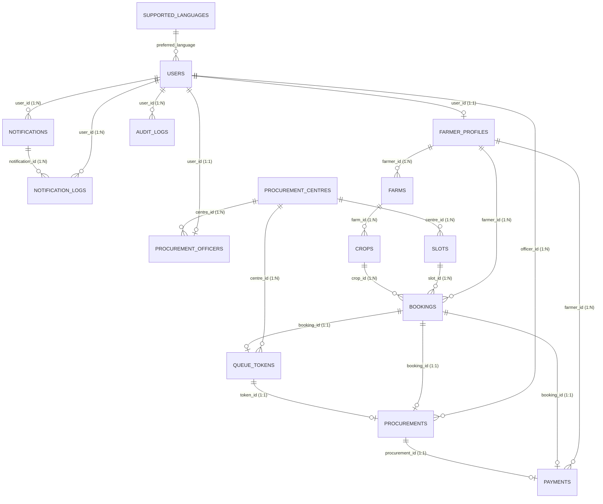

# AGRI-FLOW Database Architecture & Schema Reference

## 1. Overview

AGRI-FLOW utilizes an enterprise-grade relational schema designed for high-concurrency agricultural procurement, slot scheduling, real-time queue orchestration, Razorpay payment reconciliation, and multilingual notification delivery.

### Storage Engines Supported
- **Local Development / Testing**: SQLite (`agriflow.db` / `:memory:`)
- **Staging / Production**: PostgreSQL 14+ (`schema.sql`)
- **ORM & Dialect Abstraction**: SQLAlchemy 2.0 with Declarative Base and connection pooling (`pool_pre_ping=True`, `pool_size=10`).

---

## 2. Entity-Relationship (ER) Diagram



---

## 3. Detailed Data Dictionary

### Table 1: `supported_languages`
Stores available UI and SMS localization languages.

| Column | Data Type | Nullable | Default | Constraints | Description |
| :--- | :--- | :--- | :--- | :--- | :--- |
| `code` | `VARCHAR(10)` | NO | - | **PK** | ISO language code (e.g., `en`, `hi`, `ta`, `te`, `kn`) |
| `name` | `VARCHAR(50)` | NO | - | - | English display name (e.g., `Hindi`) |
| `native_name` | `VARCHAR(100)` | NO | - | - | Native script name (e.g., `हिन्दी`) |
| `is_active` | `BOOLEAN` | YES | `TRUE` | - | Active availability flag |
| `created_at` | `DATETIME` | YES | `utcnow()` | - | Record creation timestamp |

---

### Table 2: `users`
Central authentication and identity table with role-based access control (RBAC).

| Column | Data Type | Nullable | Default | Constraints | Description |
| :--- | :--- | :--- | :--- | :--- | :--- |
| `id` | `VARCHAR(36)` | NO | UUIDv4 | **PK** | Unique user UUID |
| `email` | `VARCHAR(255)` | NO | - | **UNIQUE, INDEX** | Account email address |
| `password_hash` | `VARCHAR(255)` | NO | - | - | Salted bcrypt password hash |
| `role` | `VARCHAR(30)` | NO | - | - | `FARMER`, `PROCUREMENT_OFFICER`, `ADMIN` |
| `full_name` | `VARCHAR(150)` | NO | - | - | Legal full name |
| `phone` | `VARCHAR(20)` | NO | - | **UNIQUE, INDEX** | E.164 formatted telephone number |
| `preferred_language` | `VARCHAR(10)` | YES | `'en'` | **FK** -> `supported_languages.code` | User's preferred notification language |
| `is_active` | `BOOLEAN` | YES | `TRUE` | - | Account active status |
| `created_at` | `DATETIME` | YES | `utcnow()` | - | Timestamp registered |
| `updated_at` | `DATETIME` | YES | `utcnow()` | - | Timestamp last updated |

---

### Table 3: `farmer_profiles`
Extended profile for agricultural producers.

| Column | Data Type | Nullable | Default | Constraints | Description |
| :--- | :--- | :--- | :--- | :--- | :--- |
| `id` | `VARCHAR(36)` | NO | UUIDv4 | **PK** | Unique farmer profile UUID |
| `user_id` | `VARCHAR(36)` | NO | - | **FK, UNIQUE** -> `users.id` (ON DELETE CASCADE) | Linked authentication user |
| `farmer_code` | `VARCHAR(30)` | NO | - | **UNIQUE, INDEX** | Human-readable ID (e.g., `FAR-172901-4492`) |
| `address` | `TEXT` | NO | - | - | Postal street address |
| `village` | `VARCHAR(100)` | NO | - | - | Revenue village / Gram Panchayat |
| `district` | `VARCHAR(100)` | NO | - | - | Administrative district |
| `state` | `VARCHAR(100)` | NO | - | - | State / Province |
| `bank_account_hash` | `VARCHAR(255)` | YES | - | - | SHA-256 hashed bank account for audit |
| `ifsc_code` | `VARCHAR(20)` | YES | - | - | Indian Financial System Code |
| `created_at` | `DATETIME` | YES | `utcnow()` | - | Creation timestamp |
| `updated_at` | `DATETIME` | YES | `utcnow()` | - | Last modification timestamp |

---

### Table 4: `farms`
Land holdings registered under each farmer.

| Column | Data Type | Nullable | Default | Constraints | Description |
| :--- | :--- | :--- | :--- | :--- | :--- |
| `id` | `VARCHAR(36)` | NO | UUIDv4 | **PK** | Unique farm plot UUID |
| `farmer_id` | `VARCHAR(36)` | NO | - | **FK** -> `farmer_profiles.id` (CASCADE) | Owner profile |
| `farm_name` | `VARCHAR(100)` | NO | - | - | Farm title or parcel descriptor |
| `location_address` | `TEXT` | NO | - | - | Physical location description |
| `district` | `VARCHAR(100)` | NO | - | - | District location |
| `land_area_acres` | `NUMERIC(10,2)` | NO | - | `CHECK (land_area_acres > 0)` | Total acreage |
| `latitude` | `NUMERIC(10,8)` | YES | - | - | GPS latitude coordinate |
| `longitude` | `NUMERIC(11,8)` | YES | - | - | GPS longitude coordinate |
| `created_at` | `DATETIME` | YES | `utcnow()` | - | Creation timestamp |
| `updated_at` | `DATETIME` | YES | `utcnow()` | - | Last update timestamp |

---

### Table 5: `crops`
Agricultural produce cultivations tied to registered farms.

| Column | Data Type | Nullable | Default | Constraints | Description |
| :--- | :--- | :--- | :--- | :--- | :--- |
| `id` | `VARCHAR(36)` | NO | UUIDv4 | **PK** | Unique crop identifier |
| `farm_id` | `VARCHAR(36)` | NO | - | **FK** -> `farms.id` (CASCADE) | Source farm |
| `crop_name` | `VARCHAR(100)` | NO | - | - | Commodity name (e.g., `Paddy`, `Wheat`) |
| `variety` | `VARCHAR(100)` | NO | - | - | Cultivar / variety (e.g., `Basmati 1121`, `Sona Masoori`) |
| `expected_quantity_kg`| `NUMERIC(12,2)` | NO | - | `CHECK (expected_quantity_kg > 0)` | Harvest yield estimate |
| `harvest_period` | `VARCHAR(100)` | NO | - | - | Season or date range (e.g., `Kharif 2026`) |
| `status` | `VARCHAR(30)` | YES | `'ACTIVE'` | - | `ACTIVE`, `HARVESTED`, `ARCHIVED` |
| `created_at` | `DATETIME` | YES | `utcnow()` | - | Record timestamp |
| `updated_at` | `DATETIME` | YES | `utcnow()` | - | Modification timestamp |

---

### Table 6: `procurement_centres`
Mandi and collection hub facilities.

| Column | Data Type | Nullable | Default | Constraints | Description |
| :--- | :--- | :--- | :--- | :--- | :--- |
| `id` | `VARCHAR(36)` | NO | UUIDv4 | **PK** | Unique centre UUID |
| `code` | `VARCHAR(30)` | NO | - | **UNIQUE, INDEX** | Facility code (e.g., `MND-DEL-01`) |
| `name` | `VARCHAR(150)` | NO | - | - | Official facility name |
| `address` | `TEXT` | NO | - | - | Physical location |
| `district` | `VARCHAR(100)` | NO | - | - | Operating district |
| `state` | `VARCHAR(100)` | NO | - | - | Operating state |
| `daily_capacity_kg` | `NUMERIC(12,2)` | YES | `50000.0` | - | Max intake capacity per operational day |
| `active_counters` | `INTEGER` | YES | `4` | `CHECK (active_counters > 0)` | Operational weighing/sampling booths |
| `avg_processing_mins_per_farmer`| `INTEGER` | YES | `15` | - | Empirical benchmark for waiting estimation |
| `latitude` | `NUMERIC(10,8)` | YES | - | - | Centre GPS latitude |
| `longitude` | `NUMERIC(11,8)` | YES | - | - | Centre GPS longitude |
| `is_active` | `BOOLEAN` | YES | `TRUE` | - | Operating state flag |
| `created_at` | `DATETIME` | YES | `utcnow()` | - | Timestamp created |
| `updated_at` | `DATETIME` | YES | `utcnow()` | - | Timestamp updated |

---

### Table 7: `procurement_officers`
Duty assignments for staff operating Mandi counters.

| Column | Data Type | Nullable | Default | Constraints | Description |
| :--- | :--- | :--- | :--- | :--- | :--- |
| `id` | `VARCHAR(36)` | NO | UUIDv4 | **PK** | Unique officer profile UUID |
| `user_id` | `VARCHAR(36)` | NO | - | **FK, UNIQUE** -> `users.id` (CASCADE) | Linked officer user account |
| `centre_id` | `VARCHAR(36)` | NO | - | **FK** -> `procurement_centres.id` (CASCADE) | Assigned collection centre |
| `counter_number` | `INTEGER` | YES | `1` | - | Operating desk / counter index |
| `is_on_duty` | `BOOLEAN` | YES | `TRUE` | - | Current active duty shift |
| `created_at` | `DATETIME` | YES | `utcnow()` | - | Registration timestamp |

---

### Table 8: `slots`
Time windows for scheduled grain delivery.

| Column | Data Type | Nullable | Default | Constraints | Description |
| :--- | :--- | :--- | :--- | :--- | :--- |
| `id` | `VARCHAR(36)` | NO | UUIDv4 | **PK** | Slot identifier |
| `centre_id` | `VARCHAR(36)` | NO | - | **FK** -> `procurement_centres.id` (CASCADE) | Operating centre |
| `slot_date` | `DATE` | NO | - | **INDEX** | Calendar date of operation |
| `start_time` | `TIME` | NO | - | - | Window opening time |
| `end_time` | `TIME` | NO | - | - | Window closing time |
| `max_capacity_kg` | `NUMERIC(12,2)` | YES | `10000.0` | - | Maximum grain intake allotment |
| `booked_capacity_kg` | `NUMERIC(12,2)` | YES | `0.0` | - | Current sum of booked crop quantities |
| `max_farmers` | `INTEGER` | YES | `30` | - | Maximum simultaneous deliveries |
| `booked_farmers` | `INTEGER` | YES | `0` | - | Count of farmers currently booked |
| `is_available` | `BOOLEAN` | YES | `TRUE` | - | Slot open for booking flag |
| `created_at` | `DATETIME` | YES | `utcnow()` | - | Creation timestamp |

**Table Constraints**:
- `UniqueConstraint('centre_id', 'slot_date', 'start_time', name='_centre_slot_unique')`

---

### Table 9: `bookings`
Confirmed intake reservations by registered farmers.

| Column | Data Type | Nullable | Default | Constraints | Description |
| :--- | :--- | :--- | :--- | :--- | :--- |
| `id` | `VARCHAR(36)` | NO | UUIDv4 | **PK** | Unique booking identifier |
| `booking_code` | `VARCHAR(30)` | NO | - | **UNIQUE, INDEX** | Reference code (e.g., `BK-20261012-0042`) |
| `farmer_id` | `VARCHAR(36)` | NO | - | **FK** -> `farmer_profiles.id` (CASCADE) | Reserving farmer |
| `slot_id` | `VARCHAR(36)` | NO | - | **FK** -> `slots.id` (RESTRICT) | Target time window |
| `crop_id` | `VARCHAR(36)` | NO | - | **FK** -> `crops.id` (RESTRICT) | Commodity to deliver |
| `expected_quantity_kg`| `NUMERIC(12,2)` | NO | - | `CHECK (expected_quantity_kg > 0)` | Reserved grain weight |
| `status` | `VARCHAR(30)` | YES | `'BOOKED'` | - | `BOOKED`, `ARRIVED`, `WAITING`, `CALLED`, `PROCESSING`, `COMPLETED`, `NO_SHOW`, `CANCELLED` |
| `created_at` | `DATETIME` | YES | `utcnow()` | - | Booking timestamp |
| `updated_at` | `DATETIME` | YES | `utcnow()` | - | Status change timestamp |

---

### Table 10: `queue_tokens`
Real-time electronic queue tokens for Mandi yard traffic management.

| Column | Data Type | Nullable | Default | Constraints | Description |
| :--- | :--- | :--- | :--- | :--- | :--- |
| `id` | `VARCHAR(36)` | NO | UUIDv4 | **PK** | Token identifier |
| `token_number` | `VARCHAR(20)` | NO | - | - | Sequential token badge (e.g., `A-001`, `B-014`) |
| `booking_id` | `VARCHAR(36)` | NO | - | **FK, UNIQUE** -> `bookings.id` (CASCADE) | Associated reservation |
| `centre_id` | `VARCHAR(36)` | NO | - | **FK** -> `procurement_centres.id` (CASCADE) | Collection facility |
| `token_date` | `DATE` | NO | - | - | Date issued |
| `position` | `INTEGER` | NO | - | - | Sequential queue rank for the day |
| `state` | `VARCHAR(30)` | YES | `'BOOKED'` | - | Token lifecycle state |
| `counter_assigned` | `INTEGER` | YES | `NULL` | - | Counter number when called |
| `arrival_time` | `DATETIME` | YES | `NULL` | - | Gate entry check-in time |
| `called_time` | `DATETIME` | YES | `NULL` | - | Time called to counter |
| `processing_start_time`| `DATETIME` | YES | `NULL` | - | Time weighing/testing commenced |
| `completed_time` | `DATETIME` | YES | `NULL` | - | Time procurement finalized |
| `created_at` | `DATETIME` | YES | `utcnow()` | - | Generation timestamp |
| `updated_at` | `DATETIME` | YES | `utcnow()` | - | Update timestamp |

**Table Constraints**:
- `UniqueConstraint('centre_id', 'token_date', 'token_number', name='_centre_token_date_unique')`
- `Index('idx_queue_lookup', 'centre_id', 'token_date', 'state')`

---

### Table 11: `procurements`
Finalized grain purchase records and quality inspection receipts.

| Column | Data Type | Nullable | Default | Constraints | Description |
| :--- | :--- | :--- | :--- | :--- | :--- |
| `id` | `VARCHAR(36)` | NO | UUIDv4 | **PK** | Procurement receipt UUID |
| `receipt_code` | `VARCHAR(30)` | NO | - | **UNIQUE, INDEX** | Serial receipt code (e.g., `RCP-20261012-0081`) |
| `token_id` | `VARCHAR(36)` | NO | - | **FK, UNIQUE** -> `queue_tokens.id` (CASCADE) | Associated queue token |
| `booking_id` | `VARCHAR(36)` | NO | - | **FK** -> `bookings.id` (CASCADE) | Original booking |
| `officer_id` | `VARCHAR(36)` | NO | - | **FK** -> `users.id` | Procuring officer |
| `actual_quantity_kg` | `NUMERIC(12,2)` | NO | - | `CHECK (actual_quantity_kg > 0)` | Certified weighbridge intake |
| `quality_grade` | `VARCHAR(10)` | NO | - | - | Tested grade (`Grade A`, `Grade B`, `Grade C`) |
| `moisture_content_pct`| `NUMERIC(5,2)` | YES | `12.0` | - | Measured moisture percentage |
| `unit_price_inr` | `NUMERIC(10,2)` | NO | - | - | Government MSP or agreed rate per kg |
| `total_amount_inr` | `NUMERIC(12,2)` | NO | - | - | Total payable: `actual_quantity_kg * unit_price_inr` |
| `status` | `VARCHAR(30)` | YES | `'COMPLETED'` | - | Procurement status |
| `remarks` | `TEXT` | YES | - | - | Inspector qualitative notes |
| `completed_at` | `DATETIME` | YES | `utcnow()` | - | Verification timestamp |

---

### Table 12: `payments`
Razorpay payment transactions and slot deposit receipts.

| Column | Data Type | Nullable | Default | Constraints | Description |
| :--- | :--- | :--- | :--- | :--- | :--- |
| `id` | `VARCHAR(36)` | NO | UUIDv4 | **PK** | Payment record UUID |
| `payment_ref` | `VARCHAR(40)` | NO | - | **UNIQUE, INDEX** | Internal transaction reference |
| `booking_id` | `VARCHAR(36)` | YES | `NULL` | **FK** -> `bookings.id` (SET NULL) | Linked slot booking |
| `procurement_id` | `VARCHAR(36)` | YES | `NULL` | **FK, UNIQUE** -> `procurements.id` (SET NULL) | Linked settlement receipt |
| `farmer_id` | `VARCHAR(36)` | NO | - | **FK** -> `farmer_profiles.id` (CASCADE) | Recipient / payer farmer |
| `razorpay_order_id` | `VARCHAR(100)` | YES | `NULL` | **UNIQUE, INDEX** | Razorpay Order Identifier (`order_...`) |
| `razorpay_payment_id` | `VARCHAR(100)` | YES | `NULL` | **UNIQUE, INDEX** | Razorpay Payment Identifier (`pay_...`) |
| `razorpay_signature` | `VARCHAR(255)` | YES | `NULL` | - | HMAC-SHA256 signature for verification |
| `amount_inr` | `NUMERIC(12,2)` | NO | `10.0` | - | Transaction value in INR |
| `currency` | `VARCHAR(10)` | YES | `'INR'` | - | Currency code |
| `payment_status` | `VARCHAR(30)` | YES | `'PENDING'` | - | `PENDING`, `SUCCESS`, `FAILED`, `REFUNDED` |
| `bank_ref_number` | `VARCHAR(100)` | YES | `NULL` | - | Bank UTR / reference code |
| `failure_reason` | `TEXT` | YES | `NULL` | - | Failure explanation if payment declined |
| `processed_at` | `DATETIME` | YES | `NULL` | - | Settlement completion timestamp |
| `created_at` | `DATETIME` | YES | `utcnow()` | - | Order initiation timestamp |
| `updated_at` | `DATETIME` | YES | `utcnow()` | - | Status update timestamp |

---

### Table 13: `notifications`
In-app and system-level user alerts.

| Column | Data Type | Nullable | Default | Constraints | Description |
| :--- | :--- | :--- | :--- | :--- | :--- |
| `id` | `VARCHAR(36)` | NO | UUIDv4 | **PK** | Notification UUID |
| `user_id` | `VARCHAR(36)` | NO | - | **FK** -> `users.id` (CASCADE) | Recipient user |
| `title` | `VARCHAR(200)` | NO | - | - | Notification subject header |
| `message` | `TEXT` | NO | - | - | Notification body text |
| `language` | `VARCHAR(10)` | YES | `'en'` | - | Localization language code |
| `event_type` | `VARCHAR(50)` | NO | - | - | Lifecycle trigger (e.g., `REGISTRATION_WELCOME`, `BOOKING_CONFIRMED`) |
| `is_read` | `BOOLEAN` | YES | `FALSE` | - | In-app read status indicator |
| `channel` | `VARCHAR(20)` | YES | `'SMS'` | - | Delivery channel (`SMS`, `IN_APP`, `EMAIL`) |
| `created_at` | `DATETIME` | YES | `utcnow()` | - | Generation timestamp |

---

### Table 14: `notification_logs`
Audit log of external telephony dispatch operations via Twilio API.

| Column | Data Type | Nullable | Default | Constraints | Description |
| :--- | :--- | :--- | :--- | :--- | :--- |
| `id` | `VARCHAR(36)` | NO | UUIDv4 | **PK** | Dispatch audit log UUID |
| `notification_id` | `VARCHAR(36)` | YES | `NULL` | **FK** -> `notifications.id` (SET NULL) | Associated notification |
| `user_id` | `VARCHAR(36)` | YES | `NULL` | **FK** -> `users.id` (SET NULL) | Target user |
| `recipient_phone` | `VARCHAR(20)` | NO | - | - | E.164 phone number targeted |
| `masked_phone_number`| `VARCHAR(20)` | YES | `NULL` | - | Privacy-safe phone mask (e.g., `+91 ••••• •1234`) |
| `provider` | `VARCHAR(30)` | YES | `'TWILIO'` | - | Gateway provider |
| `event_type` | `VARCHAR(50)` | NO | - | - | Lifecycle dispatch event |
| `language` | `VARCHAR(10)` | NO | - | - | Rendered template language |
| `rendered_message` | `TEXT` | NO | - | - | Exact body dispatched to telephony provider |
| `provider_message_id`| `VARCHAR(100)`| YES | `NULL` | - | Twilio SID (`SM...`) |
| `delivery_status` | `VARCHAR(30)` | YES | `'QUEUED'` | - | `QUEUED`, `SENT`, `DELIVERED`, `UNDELIVERED`, `FAILED` |
| `error_code` | `VARCHAR(50)` | YES | `NULL` | - | Telephony provider numeric or code error |
| `error_message` | `TEXT` | YES | `NULL` | - | Carrier or validation failure description |
| `sent_at` | `DATETIME` | YES | `utcnow()` | - | Provider dispatch timestamp |

---

### Table 15: `audit_logs`
System-wide security and compliance activity journal.

| Column | Data Type | Nullable | Default | Constraints | Description |
| :--- | :--- | :--- | :--- | :--- | :--- |
| `id` | `VARCHAR(36)` | NO | UUIDv4 | **PK** | Audit entry UUID |
| `user_id` | `VARCHAR(36)` | YES | `NULL` | **FK** -> `users.id` (SET NULL) | Actor responsible for mutation |
| `action` | `VARCHAR(100)` | NO | - | - | Action taken (e.g., `PAYMENT_VERIFIED`, `SLOT_BOOKED`, `QUEUE_CALLED`) |
| `entity_type` | `VARCHAR(50)` | NO | - | - | Affected entity (e.g., `BOOKING`, `PAYMENT`, `TOKEN`) |
| `entity_id` | `VARCHAR(100)`| YES | `NULL` | - | Primary key of mutated entity |
| `details` | `TEXT` | YES | `NULL` | - | JSON serialized context or modification metadata |
| `created_at` | `DATETIME` | YES | `utcnow()` | - | Immutable event timestamp |

---

## 4. Key Architectural Patterns & Concurrency Control

1. **Pessimistic Slot Capacity Locking (`SELECT ... FOR UPDATE`)**:
   - High-concurrency booking requests lock the target `slots` row during payment verification:
     ```python
     slot = db.query(Slot).filter(Slot.id == booking.slot_id).with_for_update().first()
     ```
   - Prevents race conditions where two farmers book the final remaining slot capacity concurrently.

2. **Compound Unique Constraints**:
   - `_centre_slot_unique`: A procurement centre cannot have overlapping time slot allocations for the identical start time.
   - `_centre_token_date_unique`: Token numbers are reset and uniquely tracked per centre and per date.

3. **Composite Indexing for Sub-Second Live Queue Lookups**:
   - `idx_queue_lookup` on `queue_tokens (centre_id, token_date, state)` ensures instant queue depth calculation and counter status rendering over WebSocket streams.

4. **Self-Healing Schema Migrations**:
   - In SQLite environments where legacy schemas may lack newer fields, `backend/app/core/database.py` executes dynamic table reflection via `PRAGMA table_info` and applies non-destructive `ALTER TABLE ADD COLUMN` operations at application boot.
